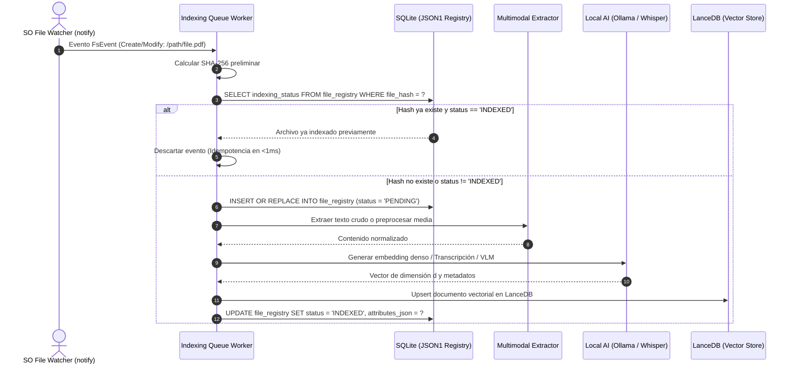
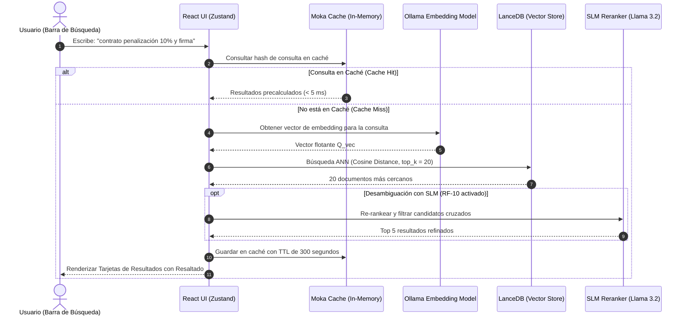

# Arquitectura de Base de Datos y Persistencia NoSQL — OmniSearch Desktop

> **Estado:** Aprobado / Especificación Técnica  
> **Alcance:** Modelo de datos, motores de persistencia, colas, caché y análisis comparativo de tecnologías.  
> **Ubicación:** `docs/architecture/database_architecture.md`

---

## 1. Resumen Ejecutivo y Contexto del Proyecto

**OmniSearch Desktop** es un explorador semántico local y multimodal desarrollado con **Tauri v2 (Rust) y React/TypeScript**. A diferencia de las aplicaciones web convencionales o arquitecturas cliente-servidor en la nube, OmniSearch opera como una **aplicación de escritorio autónoma, soberana y 100% privada (Zero Telemetry)**.

Para satisfacer esta visión, la capa de persistencia debe cumplir rigurosamente con dos requerimientos no funcionales críticos definidos en el PRD:
1. **RNF-01 (100% Local / Cero Dependencias Externas):** La aplicación no puede exigir al usuario instalar daemons de base de datos de terceros, configurar puertos de red locales ni ejecutar contenedores Docker para poder funcionar. Debe ser un ejecutable nativo "doble-clic y listo".
2. **RNF-04 (Consumo de Memoria en Reposo < 60 MB RAM):** En reposo, la aplicación completa de escritorio no debe asfixiar la memoria RAM del equipo del usuario.
3. **RNF-08 (Escalabilidad de Almacenamiento ≥ 100,000 archivos):** El motor debe ser capaz de indexar y buscar sobre colecciones densas sin degradar la latencia sub-segundo (< 500 ms en RNF-03).

A continuación se presenta el análisis técnico que justifica por qué se optó por un **Stack NoSQL Embebido Dual (LanceDB + SQLite-JSON1)** y primitivas de memoria en Rust, en lugar de un despliegue tradicional basado en servidores externos como **MongoDB y Redis**.

---

## 2. Análisis Comparativo: MongoDB + Redis vs. Stack NoSQL Embebido

Durante la fase de diseño preliminar se evaluó la combinación clásica de la industria: **MongoDB** (base de datos documental NoSQL flexible) junto a **Redis** (almacén clave-valor en memoria para colas y caché).

A continuación se detalla la comparativa técnica entre ambas alternativas:

```mermaid
graph TD
    subgraph "Opción Evaluada: Servidores Externos (MongoDB + Redis)"
        A1[Tauri App / Rust Backend] -->|TCP Socket / Loopback| B1[MongoDB Daemon (mongod)]
        A1 -->|TCP Socket / Port 6379| C1[Redis Server Daemon]
        B1 -.->|Consumo RAM: 500 MB - 1.5 GB| D1[Huella Pesada en Sistema]
        C1 -.->|Requiere Docker / WSL en Windows| D1
    end

    subgraph "Opción Seleccionada: Stack NoSQL Embebido In-Process"
        A2[Tauri App / Rust Backend] -->|Llamada nativa de memoria| B2[LanceDB (Arrow Columnar / Vectores)]
        A2 -->|Llamada C-ABI / In-Process| C2[SQLite JSON1 (Metadata & Hashes)]
        A2 -->|Tokio MPSC & Moka Cache| D2[Colas & Caché en Memoria Nativa]
        B2 & C2 & D2 -.->|Consumo RAM: < 35-50 MB en reposo| E2[Zero Setup / Portabilidad Total]
    end
```

### Tabla Comparativa de Atributos de Calidad

| Criterio | Enfoque Servidor (MongoDB + Redis) | Enfoque Embebido Seleccionado (LanceDB + SQLite-JSON1 + Tokio/Moka) | Veredicto para OmniSearch Desktop |
| :--- | :--- | :--- | :--- |
| **Instalación y UX** | Requiere que el usuario instale MongoDB y Redis como servicios de SO o instale Docker Desktop. | **Cero instalación externa.** Los motores corren dentro del binario compilado de Tauri/Rust. | 🏆 **Embebido** (Crucial para adopción de usuarios no técnicos). |
| **Consumo de Memoria (RAM en reposo)** | **> 600 MB - 1.2 GB** (MongoDB consume ~400-800 MB; Redis ~50-100 MB más overhead de red). | **< 35 - 50 MB** en reposo para todo el proceso Tauri. | 🏆 **Embebido** (Cumple estrictamente con el RNF-04: <60 MB). |
| **Búsqueda Vectorial Multimodal** | Requiere MongoDB Atlas Vector Search (nube) o extensiones pesadas; no nativo offline ligero. | **LanceDB nativo in-process:** Diseñado para búsqueda vectorial densa + metadatos sobre Apache Arrow. | 🏆 **Embebido** (Óptimo para embeddings y similitud coseno). |
| **Latencia de Acceso (IPC / I/O)** | Latencia TCP sobre localhost / loopback (~0.5 - 2.0 ms por consulta simple). | **Llamada de función in-process / Zero-Copy** en memoria compartida (< 0.05 ms). | 🏆 **Embebido** (10x a 40x más rápido en transacciones unitarias). |
| **Portabilidad Multiplataforma** | Redis no tiene soporte nativo oficial para Windows (requiere puertos no oficiales o WSL2). MongoDB en macOS/Windows requiere instaladores de 500+ MB. | Rust compila LanceDB y SQLite de forma estática y nativa para Windows (x86_64), macOS (Apple Silicon M1-M4) y Linux. | 🏆 **Embebido** (Cumple RNF-09). |
| **Flexibilidad de Esquema (NoSQL)** | Documentos BSON con esquemas dinámicos. | **Totalmente equivalente:** LanceDB admite esquemas Arrow anidados dinámicos; SQLite soporta tipos JSON documentales nativos (`json_extract`, `json_set`). | 🤝 **Empate técnico** en expresividad documental. |

### Conclusión del Análisis
Aunque MongoDB y Redis son líderes indiscutibles en arquitecturas web distribuidas y servidores cloud, **en una aplicación de escritorio nativa orientada a la privacidad local representan un severo antipatrón de empaquetado y consumo de recursos**.

Por tanto, se adopta formalmente la arquitectura **NoSQL Embebida Dual**, manteniendo la filosofía de documentos flexibles sin el peso de servicios de fondo.

---

## 3. Arquitectura del Stack de Persistencia Seleccionado

La persistencia de OmniSearch Desktop se divide en tres niveles especializados, todos ejecutándose en el mismo espacio de memoria del proceso Rust:

```
┌────────────────────────────────────────────────────────────────────────┐
│                   TAURI APPLICATION LAYER (Rust Backend)                │
└───────────────────────────────────┬────────────────────────────────────┘
                                    │
    ┌───────────────────────────────┼───────────────────────────────┐
    │                               │                               │
┌───▼─────────────────────┐ ┌───────▼─────────────────────┐ ┌───────▼─────────────────────┐
│ 1. Vector & Doc Store   │ │ 2. Metadata & Hash Store    │ │ 3. Fast Cache & Job Queue   │
│       (LanceDB)         │ │     (SQLite + JSON1)        │ │    (Tokio MPSC + Moka)      │
├─────────────────────────┤ ├─────────────────────────────┤ ├─────────────────────────────┤
│ - Embeddings densos     │ │ - Deduplicación SHA-256     │ │ - Concurrencia de ingesta   │
│ - Transcripciones audio │ │ - Estados (PENDING/DONE)    │ │ - Caché LRU de consultas    │
│ - Captions de imágenes  │ │ - Atributos JSON dinámicos  │ │ - Throttling de hardware    │
│ - Búsqueda Coseno/ANN   │ │ - Transacciones ACID rápidas│ │ - Latencia en nanosegundos  │
│ - Apache Arrow Columnar │ │ - Motor in-process ligero   │ │ - Sin procesos externos     │
└─────────────────────────┘ └─────────────────────────────┘ └─────────────────────────────┘
```

### 3.1 LanceDB: Base de Datos Vectorial y Documental Columnar
* **Rol:** Almacén primario de conocimiento semántico y documentos enriquecidos multimodalmente.
* **Formato Subyacente:** **Apache Arrow** y formato **Lance**, diseñado para lecturas vectoriales masivas con soporte zero-copy.
* **Características Clave:**
  - Embebido directamente en Rust (`lancedb` crate).
  - Almacena vectores densos (ej. 384 dimensiones de `bge-small-en-v1.5` o 768 de `nomic-embed-text`) junto con metadatos anidados arbitrarios (documento NoSQL) en la misma fila.
  - Soporta indexación vectorial rápida (IVF-PQ) para colecciones de más de 100,000 registros sin cargar toda la base en memoria RAM.

### 3.2 SQLite con Extensión JSON1: Almacén Documental Transaccional y de Control
* **Rol:** Registro transaccional de alta velocidad para control de duplicados, estado del pipeline de ingesta y metadatos dinámicos del sistema de archivos.
* **Por qué modo Documental JSON1:**
  - Permite guardar estructuras de datos heterogéneas sin necesidad de migraciones de tablas complejas cada vez que un extractor multimodal agrega nuevos campos (ej. metadatos EXIF en fotos, duración de audio, número de páginas de un PDF).
  - Consultas y filtros directos sobre atributos JSON utilizando operadores indexables (`json_extract(attributes, '$.author')`).
  - Garantiza **ACID inmediato** para evitar que cortes de energía o caídas de la app dejen archivos a medio procesar.

### 3.3 Sustituto de Redis: Tokio MPSC Channels + Moka Cache
En lugar de levantar un socket hacia un servidor Redis externo, Rust ofrece abstracciones nativas superiores para una aplicación de escritorio:
1. **Para Colas de Ingesta (antes Redis LPUSH/RPOP):**
   - Canales asíncronos en memoria `tokio::sync::mpsc::channel`.
   - Control de estrangulamiento (*throttling*) mediante `tokio::sync::Semaphore` (limita a un máximo de 2 archivos procesados simultáneamente para no saturar la CPU/GPU, cumpliendo con RNF-05).
2. **Para Caché de Consultas y Re-ranking (antes Redis GET/SET):**
   - Crate `moka` en Rust (caché concurrente ultra-rápida inspirada en Caffeine).
   - Políticas de expiración automática por tiempo (TTL) y límite de memoria (LRU), evitando recalcular embeddings para consultas idénticas o muy frecuentes con latencias de < 1 microsegundo.

---

## 4. Esquemas de Datos (Data Models)

### 4.1 Esquema LanceDB (Documento Vectorial Multimodal)

Cada fragmento o archivo indexado se persiste en la tabla `multimodal_embeddings` de LanceDB bajo el siguiente esquema lógico en formato Apache Arrow / Documental:

```json
{
  "id": "uuid-v4-string",
  "file_hash": "a591a6d40bf420404a011733cfb7b190d62c65bf0bcda32b57b277d9ad9f146e",
  "file_path": "/Users/usuario/Documents/contrato_alquiler.pdf",
  "file_name": "contrato_alquiler.pdf",
  "mime_type": "application/pdf",
  "category": "document", 
  "chunk_index": 0,
  "chunk_text": "Cláusula 10: La penalización por incumplimiento anticipado será del 10% del total acordado...",
  "vector": [0.0142, -0.0521, 0.0891, "...(384 o 768 dimensiones)"],
  "multimodal_metadata": {
    "source_type": "pdf_text",
    "page_number": 3,
    "vlm_caption": null,
    "stt_speaker": null,
    "confidence_score": 0.98,
    "extracted_keywords": ["penalización", "contrato", "incumplimiento", "10%"]
  },
  "created_at": 1729900000,
  "updated_at": 1729900000
}
```

#### Para Imágenes (VLM - Visión Computacional):
```json
{
  "id": "img-uuid-v4",
  "file_hash": "c8b4...",
  "file_path": "/Users/usuario/Downloads/firma_contrato.jpg",
  "file_name": "firma_contrato.jpg",
  "mime_type": "image/jpeg",
  "category": "image",
  "chunk_index": 0,
  "chunk_text": "Fotografía en primer plano de una firma manuscrita con tinta azul sobre papel membretado...",
  "vector": [-0.0341, 0.0112, "..."],
  "multimodal_metadata": {
    "source_type": "vlm_moondream",
    "ocr_detected_text": "Aceptado y firmado: Juan Pérez - 15/08/2026",
    "visual_tags": ["firma", "documento", "tinta azul", "rúbrica"],
    "image_resolution": "1920x1080"
  },
  "created_at": 1729900100,
  "updated_at": 1729900100
}
```

### 4.2 Esquema SQLite-JSON1 (Deduplicación y Estado de Ingesta)

Tabla relacional-documental en `index.db` para control de ciclo de vida:

```sql
CREATE TABLE IF NOT EXISTS file_registry (
    file_hash TEXT PRIMARY KEY,                   -- SHA-256 de los primeros bloques / archivo completo
    file_path TEXT NOT NULL,                      -- Ruta absoluta actual del archivo
    file_size_bytes INTEGER NOT NULL,             -- Tamaño para detectar modificaciones rápidas
    last_modified_timestamp INTEGER NOT NULL,     -- mtime reportado por el sistema de archivos
    mime_type TEXT NOT NULL,                      -- application/pdf, image/png, audio/wav, etc.
    indexing_status TEXT NOT NULL CHECK(          -- Estado en la máquina de estados
        indexing_status IN ('PENDING', 'PROCESSING', 'INDEXED', 'FAILED', 'IGNORED')
    ),
    retry_count INTEGER DEFAULT 0,                -- Reintentos permitidos ante fallos de inferencia
    last_error_message TEXT,                      -- Registro de errores si falló el procesamiento
    attributes_json TEXT NOT NULL DEFAULT '{}',   -- Documento NoSQL (JSON flexible) con metadatos específicos
    indexed_at INTEGER                            -- Timestamp UNIX de finalización
);

-- Índices de alta velocidad para consultas en microsegundos
CREATE INDEX IF NOT EXISTS idx_file_registry_path ON file_registry(file_path);
CREATE INDEX IF NOT EXISTS idx_file_registry_status ON file_registry(indexing_status);
```

#### Ejemplo de `attributes_json` (Documento NoSQL en SQLite):
```json
{
  "audio_duration_seconds": 142.5,
  "whisper_model_used": "whisper.cpp-small",
  "total_chunks_indexed": 4,
  "user_custom_tags": ["finanzas", "urgente"],
  "hardware_ingestion_mode": "cpu_fallback"
}
```

---

## 5. Flujos de Trabajo e Interacción de Datos

### 5.1 Flujo de Ingesta y Deduplicación Idempotente (Watch Pipeline)



### 5.2 Flujo de Búsqueda Semántica con Caché (Search Pipeline)



---

## 6. Mapeo con la Arquitectura Hexagonal del Proyecto

Siguiendo las directrices de `architecture.md`, el sistema de base de datos se integra mediante **Puertos y Adaptadores**, garantizando desacoplamiento total:

```text
src-tauri/src/
├── ports/
│   ├── vector_store.rs          # Trait VectorStore (search_cosine, upsert_document)
│   ├── metadata_store.rs        # Trait MetadataStore (get_by_hash, mark_indexed, update_attributes)
│   └── cache_store.rs           # Trait CacheStore (get, set, invalidate)
│
└── adapters/
    └── persistence/
        ├── lance_db.rs          # Implementación de VectorStore usando LanceDB
        ├── sqlite_meta.rs       # Implementación de MetadataStore usando rusqlite (JSON1)
        └── memory_cache.rs      # Implementación de CacheStore usando Moka en memoria
```

### Definición de los Traits (Puertos)

```rust
#[async_trait::async_trait]
pub trait VectorStore: Send + Sync {
    async fn upsert(&self, doc: VectorDocument) -> Result<(), DomainError>;
    async fn search_cosine(&self, query_vec: &[f32], limit: usize) -> Result<Vec<SearchResult>, DomainError>;
}

#[async_trait::async_trait]
pub trait MetadataStore: Send + Sync {
    async fn get_by_hash(&self, hash: &str) -> Result<Option<FileRegistryItem>, DomainError>;
    async fn set_status(&self, hash: &str, status: IndexingStatus) -> Result<(), DomainError>;
    async fn save_attributes(&self, hash: &str, attributes: serde_json::Value) -> Result<(), DomainError>;
}
```

---

## 7. Plan de Escalabilidad y Almacenamiento en Disco

Para una biblioteca típica de **100,000 archivos** de usuario indexados:
* **Espacio en LanceDB:**
  - Embeddings de 384 dimensiones en `f32`: `384 * 4 bytes ≈ 1.5 KB` por chunk.
  - Con un promedio de 3 chunks por archivo: `100,000 * 3 * 1.5 KB ≈ 450 MB` de datos vectoriales.
  - Formato Lance con compresión columnar: **~350 - 500 MB en disco SSD**.
* **Espacio en SQLite (`index.db`):**
  - Registro de hashes y atributos JSON: `~500 bytes` por archivo.
  - Para 100,000 archivos: **~50 MB en disco**.
* **Total Huella en Disco:** Menos de **600 MB** de almacenamiento local para indexar toda la vida digital del usuario, manteniendo la base de datos 100% compacta, portable y resguardada en la carpeta de datos de la aplicación (`AppData` en Windows, `Application Support` en macOS, `.local/share` en Linux).
