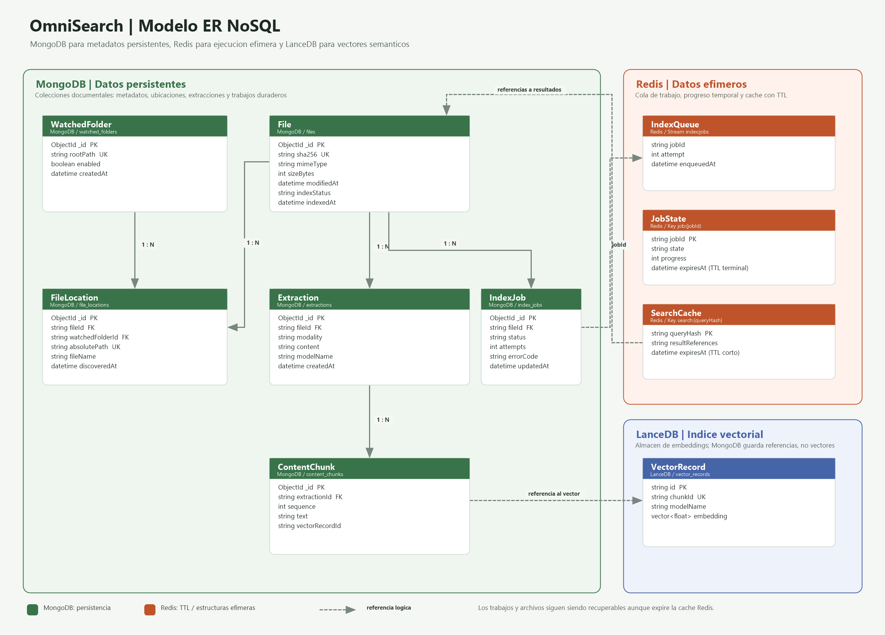
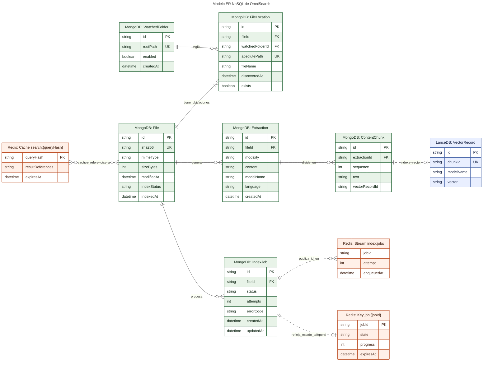

# Modelo ER NoSQL propuesto

> Modelo lógico para una evolución del almacenamiento de OmniSearch. La arquitectura documentada actualmente usa SQLite para metadatos y LanceDB para vectores; este diseño propone MongoDB para los metadatos y Redis para estructuras efímeras de ejecución. LanceDB continúa como almacén vectorial.

## Colecciones MongoDB

- `files`: un documento canónico por hash SHA-256. Un contenido repetido reutiliza sus extracciones y vectores; cada copia física se registra por separado en `file_locations`.
- `file_locations`: relaciona el archivo lógico con cada ruta detectada y, cuando aplique, con la carpeta vigilada. Así se conserva la deduplicación sin perder las rutas alternativas.
- `extractions`: guarda texto extraído, caption de imágenes o transcripción de audio, junto con modalidad y modelo que produjo el resultado.
- `content_chunks`: fragmentos direccionables para búsquedas y embeddings. Se mantienen separados de `extractions` para evitar documentos MongoDB sin límite práctico de tamaño.
- `index_jobs`: registro duradero del ciclo de indexación, incluidos reintentos y errores. Redis no es la fuente de verdad del estado del trabajo.
- `watched_folders`: configuración de las carpetas monitorizadas.

## Estructuras Redis

- `index:jobs`: Redis Stream con grupos de consumidores para entregar trabajos pendientes al worker; cada entrada transporta el `jobId`, no el archivo completo.
- `job:{jobId}`: progreso consultable por la UI. Mantener mientras el trabajo está activo; aplicar TTL únicamente al estado terminal.
- `search:{queryHash}`: resultados recientes con referencias a archivos y puntuaciones. Aplicar un TTL corto y configurable; la pérdida de esta caché no afecta a los datos persistentes.

## Reglas de persistencia

1. Crear un índice único para `files.sha256` y otro para `file_locations.absolutePath` normalizada. Si el hash ya existe en otra ruta, agregar una ubicación y reutilizar el contenido indexado.
2. Persistir primero el `index_job` en MongoDB y publicar su identificador en Redis. Si falla la publicación, un reconciliador puede volver a encolar los trabajos duraderos pendientes.
3. Guardar los embeddings en LanceDB; MongoDB conserva `vectorRecordId` como referencia, no el vector denso. La clave del vector debe ser estable por fragmento y modelo.
4. Al completar o fallar un trabajo, actualizar MongoDB como registro duradero y Redis como estado de ejecución/consulta temporal.
5. Tratar rutas, captions, transcripciones y consultas como datos privados locales, de acuerdo con RNF-01.

## Límites del modelo

Este diagrama describe una propuesta NoSQL alineada con la deduplicación, indexación multimodal y cola asíncrona de la documentación. No implica que MongoDB o Redis ya estén integrados en el código actual ni reemplaza a LanceDB para búsqueda vectorial.